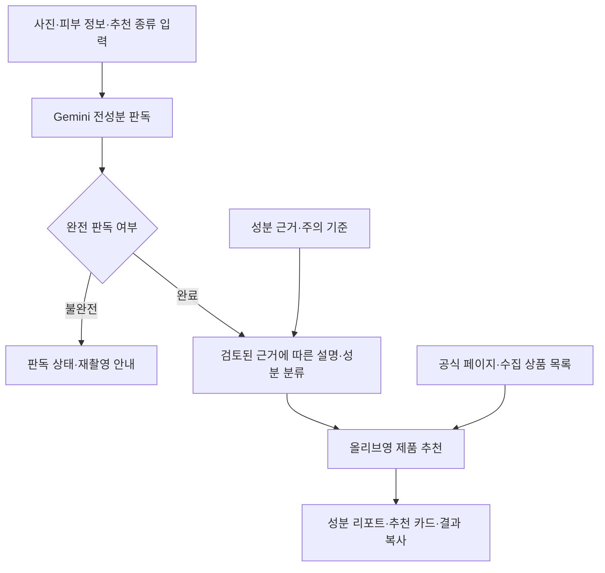

# ✦ GlowPick

**화장품 전성분을 읽고, 피부 고민에 맞는 성분 정보와 스킨케어 제품 후보를 확인하는 서비스**

전성분 라벨 사진과 피부 정보를 입력하면 Gemini가 사진을 판독합니다. 앱은 판독한 성분을 검토된 자료와 대조해 도움과 관련된 기능, 주의해서 볼 성분, 추가 확인이 필요한 성분을 구분합니다. 분석을 완료하면 **GlowPick 추천!**에서 올리브영 스킨케어 제품도 확인할 수 있습니다.

[웹에서 사용하기](https://yumin0601-glowpick.static.hf.space/index.html) · [Hugging Face Space](https://huggingface.co/spaces/yumin0601/GlowPick) · [Android 빌드 결과](https://github.com/yumin0117/GlowPick/actions/runs/43780310567)

> 최종 통합 소스는 **main**을 기준으로 관리합니다. 추가 기능을 담당 브랜치별로 분리하지 않고, 한국 브랜드 100개 검증과 Android 앱을 포함한 통합 작업을 main에서 유지합니다. 개인 브랜치는 기존 작업 이력으로 보존합니다.

## 주요 기능

### 화장품 성분 분석

- 한 제품의 전성분 라벨 사진을 판독하고 성분 목록과 원문을 표시합니다.
- 피부 타입과 여러 피부 고민을 함께 선택할 수 있습니다.
- 글리세린 외에도 검토된 근거가 있는 보습·피부 컨디셔닝 성분을 연결합니다.
- 판독된 성분과 사용자 조건에 해당하는 경우 향료 등 주의해서 확인할 일반 안내를 표시합니다.
- 근거가 부족한 성분은 추가 확인 항목으로 구분합니다.
- 일부 판독·판독 불가·여러 제품 감지 등의 상태를 완료 결과와 구분합니다.
- 결과 복사로 성분 목록과 안내를 저장할 수 있습니다.

### 모델링팩 컨설팅

모델링팩 전성분과 피부 고민을 확인하고 에센스·세럼·앰플 후보를 추천합니다. 제품 추천은 특정 모델링팩에 섞어도 된다는 허용 판정이 아닙니다. 정확한 제품·버전·사용 조건의 근거가 없으면 **혼합 가능 여부 미확인**으로 안내하며 제조사의 사용법을 우선합니다.

### GlowPick 추천!

| 분석 서비스 | 추천받을 수 있는 종류 | 선택 제한 | 선택했을 때 | 선택하지 않았을 때 |
| --- | --- | --- | --- | --- |
| 화장품 성분 분석 | 스킨·토너·에센스·세럼·앰플·크림·로션 | 선택 사항, 최대 3종 | 선택한 종류마다 서로 다른 제품 1개 | 허용 종류 중 최대 3개 |
| 모델링팩 컨설팅 | 에센스·세럼·앰플 | 선택 사항, 최대 1종 | 선택한 종류의 제품 1개 | 허용 종류 중 최대 3개 |

여러 고민을 선택하면 함께 고려해 후보를 비교합니다. 스킨과 토너는 구분하며, 선택한 종류를 다른 종류로 임의 대체하지 않습니다.

추천은 다음 순서로 처리합니다.

1. Gemini가 올리브영 공식 카테고리 페이지를 읽고 조건에 맞는 제품 후보를 찾습니다.
2. 부족한 종류가 있으면 수집된 공식 목록을 제공해 실제 상품 ID를 선택하게 합니다. 제품명·브랜드·사진·상품 주소는 해당 ID의 자료에서 연결합니다.
3. 추천 API가 지연되거나 완료되지 않으면 같은 수집 목록의 상품명에 표시된 관리 특징과 고민·종류를 비교합니다. 이 경우 화면에 목록 비교 추천임을 안내하며 AI 실호출 성공으로 기록하지 않습니다.

추천용 수집 목록은 **122개 상품**이며, 한국 브랜드 100개 판독 테스트 자료와 별개입니다. 몇 개의 추천 상품을 직접 고정한 목록은 아니지만 올리브영 전체 재고도 아닙니다. 요청마다 자동 재수집되지 않으므로 새 상품·단종·리뉴얼과 현재 판매 여부를 모두 즉시 반영하지는 못합니다.

링크나 사진이 없어도 확인된 제품명과 추천 이유를 표시합니다. 확인한 공식 상품 주소가 있으면 바로가기를 제공하고, 제품 사진은 확인된 공식 CDN 주소가 있을 때 표시합니다. 사진 로딩이 실패해도 제품 카드는 유지합니다.

현재 화면과 결과 복사에는 수집·조회 시간을 표시하지 않습니다. **‘다시 추천 받기’ 버튼은 제거했으며**, 최초 성분 분석 완료 후의 제품 추천을 제공합니다.

## 사용 방법

1. 웹 또는 설치한 Android 앱을 엽니다.
2. 본인의 Gemini API 키를 입력합니다. 수업 시연에서는 결제가 연결되지 않은 무료 프로젝트 키를 사용합니다.
3. 화장품 성분 분석 또는 모델링팩 컨설팅을 선택합니다.
4. 한 제품의 전성분 전체가 보이는 사진을 올리거나 촬영합니다.
5. 피부 타입과 고민을 선택합니다. 피부 타입을 모르면 ‘잘 모르겠음’을 선택할 수 있습니다.
6. 원하는 추천 종류를 선택하거나 비워 둔 뒤 분석합니다.
7. 성분 리포트와 제품 추천을 확인하고, 필요하면 결과를 복사합니다.

지원 파일은 **JPG/JPEG·PNG·WEBP 정지 이미지**, 최대 **10MiB·2,400만 픽셀**입니다.

API 키는 현재 탭에서 반복 분석할 때 재사용합니다. 새로고침·페이지 이동·탭 닫기 또는 앱 화면 재생성 시 초기화합니다. 브라우저 저장소에 저장하지 않으며 앱에 공용 키를 포함하지 않습니다. 키와 사진·피부 입력은 분석을 위해 브라우저에서 Google로 직접 전송됩니다. API 이용 요금과 한도는 입력한 키의 프로젝트 설정을 따릅니다.

## 동작 구조



Hugging Face에서는 **Static Space**로 실행합니다. 화면과 API 클라이언트가 브라우저에 있고 Google Gemini API에 직접 요청하므로 별도 운영 서버나 HF Secrets가 필요하지 않습니다. 코드에 설정된 모델은 `gemini-3.5-flash-lite`, 판독·설명 프롬프트 버전은 `v2-2026-11-04`입니다.

기존 Python·Gradio 구현은 비교와 회귀 검사 용도로 보관합니다. 현재 웹과 Android 앱의 운영 경로는 `BeautyAI/`의 JavaScript 모듈입니다.

## 프로젝트 구성

| 경로 | 역할 |
| --- | --- |
| `BeautyAI/index.html`, `style.css`, `script.js` | 화면, 입력·사진 관리, 탭 내 키 재사용, 결과 표시 |
| `BeautyAI/api-client.js` | 성분 분석·제품 추천 클라이언트 연결 |
| `BeautyAI/gemini-client.js` | 사진 판독·설명 API 요청, 이미지 검사, 실패 단계·오류 진단 |
| `BeautyAI/recommendation-client.js` | 올리브영 조회, 추천 지시, 종류·주소 검사, 목록 기반 추천 처리 |
| `BeautyAI/report-model.js` | 근거 대조, 도움·주의·추가 확인 분류, 추천 상태와 복사 결과 구성 |
| `BeautyAI/ai-core.js` | 응답 스키마·판독 상태 검사 |
| `BeautyAI/ai-assets.js` | 스키마·프롬프트·성분 근거·상품 목록의 자동 생성 묶음 |
| `prompts/` | 판독·설명 프롬프트 원본 |
| `data/` | 성분 기능·주의 기준·출처·추천 상품 목록 |
| `reference/` | 기존 성분 비교용 자료와 검증 도구 |
| `tests/` | 웹 기능·API 계약·오류 처리 자동검사 |
| `scripts/` | 로컬 실행, 자료 정리, 자산 생성, 배포 파일 구성 |
| `mobile/` | Capacitor 기반 Android 시연 앱과 설치·빌드 안내 |
| `.github/workflows/android-demo.yml` | APK 빌드·lint·에뮬레이터 검사 |
| `glowpick/`, `app.py` | 이전 Python 구현과 비교·회귀 검사 |
| `docs/` | 기능 변경·통합·검증·배포 기록 |

팀의 기존 담당은 **mj: API·서버 연동 / kyoungmin_oh: 프롬프트 / ysw: 성분표 수집·검증 / ym: 화면**입니다. 최종 기능은 main에 통합해 관리합니다.

## 로컬 실행

Node.js 22 이상에서 저장소 루트를 기준으로 실행합니다. 화면 미리보기에는 npm 패키지 설치가 필요하지 않습니다.

```powershell
node scripts/dev-static.mjs
```

브라우저에서 [http://127.0.0.1:8080/](http://127.0.0.1:8080/)을 엽니다. API 키는 실행 화면에 직접 입력합니다. `file://`로 HTML을 열면 모듈이 제한되므로 로컬 HTTP 서버를 사용합니다.

프롬프트·성분 자료·상품 목록·모델 스키마를 수정한 경우, 프로젝트 Python 의존성을 설치한 환경에서 공개 자산을 다시 생성합니다.

```powershell
python scripts/build_static_assets.py
```

`ai-assets.js`는 생성 결과이므로 해당 원본을 먼저 수정합니다.

## Hugging Face 배포

대상은 기존 [yumin0601/GlowPick](https://huggingface.co/spaces/yumin0601/GlowPick) Space입니다.

```powershell
python scripts/package_static.py GlowPick_HF_Final.zip
```

프로젝트 Python 의존성이 설치된 환경에서 실행합니다. ZIP에는 README와 공개 웹 파일 9개, 총 10개 파일이 들어갑니다. 압축을 풀어 Space 루트에 업로드합니다. 배포용 README는 `sdk: static`, `app_file: index.html`로 생성됩니다. Python 코드·가상환경·사진 시험 자료·API 키는 배포 묶음에 포함하지 않습니다.

2026-11-16 확인 기준, 웹 배포 커밋은 [`447aeac`](https://huggingface.co/spaces/yumin0601/GlowPick/commit/447aeacaa7ecdb483188635e7fc81c381ad091ea)입니다. 당시 RUNNING 상태와 공개 웹 파일 9개의 배포본 일치를 확인했습니다. GitHub 소스 수정은 기존 HF Space에 자동 반영되지 않으므로 웹 코드가 바뀌면 다시 배포합니다.

## Android APK

Google Play 등록 없이 휴대폰에 직접 설치하는 수업 시연용 앱입니다. `BeautyAI/`의 공개 웹 파일 9개를 Capacitor 8.6.0으로 묶습니다.

- 앱 이름: **GlowPick**
- 패키지: `io.github.yumin0117.glowpick`
- 버전: `0.1.0-demo`
- 최소 Android API: 24
- 배포 형식: 디버그 서명 APK

[검증 완료 빌드의 아티팩트](https://github.com/yumin0117/GlowPick/actions/runs/43780310567/artifacts/14188146366)에서 GitHub 로그인 후 ZIP을 내려받고 `GlowPick-Android-demo.apk`를 휴대폰으로 옮겨 설치합니다. 기존 데모와 서명이 달라 업데이트 설치가 거절되면 기존 데모를 삭제한 뒤 설치합니다. 아티팩트는 30일 보관되므로 수업용 파일은 별도로 보관합니다.

main의 웹·모바일 코드가 바뀌면 기존 APK 빌드 워크플로가 실행됩니다. 앱에 화면 파일이 포함되므로 웹 코드 수정 후 Android에서도 사용하려면 새 APK를 빌드하고 설치해야 합니다.

로컬 빌드에는 Node.js 22 이상, Java 21, Android SDK 36이 필요합니다.

```powershell
cd mobile
npm ci --ignore-scripts
npm run sync
cd android
.\gradlew.bat assembleDebug
```

출력은 `mobile/android/app/build/outputs/apk/debug/app-debug.apk`입니다. 상세 안내는 [mobile/README.md](mobile/README.md)를 참고하세요.

## 검증 기록

### 기능 자동검사

```powershell
npm test
python -m unittest discover -s tests -v
node --test reference/tests/validation.test.mjs
```

2026-11-16 Android 빌드에서 웹 자동검사 **67건**, Android lint와 API 35 에뮬레이터 계측 검사 **1건**이 통과했습니다. 해당 계측 검사는 앱 실행·가로 넘침·빈 키 초기 상태·사진 선택 및 미리보기·탭 전환·키 입력 안내를 함께 확인합니다.

최종 APK의 공개 웹 파일 9개가 빌드 소스와 일치함을 확인했습니다. Android의 화면 안전 영역을 위한 HTML·CSS 보정은 포함됩니다. 실제 휴대폰 카메라와 Android 안의 Gemini 실호출은 에뮬레이터 검사 범위에 포함되지 않습니다.

### 한국 브랜드 100개 실제 앱 검사

추천 기능 추가 전 성분 분석 수정본의 검사 기록이며, 현재 모든 추천 종류를 100개 제품으로 검증했다는 의미는 아닙니다.

| 항목 | 당시 기록 |
| --- | --- |
| 자료 | 한국 브랜드 100개 제품의 공식 전성분표 화면 캡처 |
| 파일·브라우저 업로드 검사 | 100개 통과 |
| 실제 Gemini 분석 시도 | 100개 |
| 판독 완료 상태 | 58개 |
| 여러 제품 감지 상태 | 3개 |
| API 오류 | 39개: `GEMINI_UNAVAILABLE` 35개, 당시 `GEMINI_REQUEST_REJECTED` 4개 |
| 공식 페이지 텍스트와 자동 순서 대조 | 완료 58개 중 18개 일치, 40개 추가 검토 대상 |

`complete`는 모델의 완료 상태이며 정확한 전사를 보증하는 점수가 아닙니다. 자동 대조 기준도 공식 페이지의 표시 텍스트로, 독립된 사람의 정답 교차검토를 완료한 자료는 아닙니다. 이후 오류 재검사는 최초 100개 결과와 별도로 기록했으며, 재검사 성공으로 최초 오류를 덮어쓰지 않았습니다.

원본 이미지·파일별 응답·출처·대조 결과는 로컬 검증 패키지에 보관합니다. 공개 코드와 실제 대용량 시험 파일의 보관 위치를 구분하며, 이 자료를 담당 브랜치로 분리하지 않습니다.

### 추천 기능 확인

별도 추천 모듈 실호출에서 스킨·토너·앰플 세 종류의 실제 제품명을 확인했고, 운영 추천 렌더러에서 카드와 공식 제품 사진 로딩을 확인했습니다. 이는 사진 판독부터의 전체 흐름을 모든 제품·종류에서 실호출 검증한 결과는 아닙니다.

## 결과를 읽을 때

- 성분 기능은 검토된 일반 기능 자료에 한정합니다. 완제품 효능이나 개인별 적합성·치료 효과를 판정하지 않습니다.
- 근거가 없는 성분은 `needs_evidence`, 일반 기능 설명은 `reference_only`, 확인하지 못한 혼합은 `unknown`으로 구분합니다. 주의 안내가 없다고 모든 성분이 안전하다는 의미는 아닙니다.
- 추천 상품의 현재 성분·가격·재고·사용법은 구매 전 상품 페이지와 제조사 안내에서 확인해야 합니다.
- 분석은 탭 내 동시 요청과 분당 횟수를 제한합니다. 성분 분석의 각 API 요청 제한은 기본 45초, 추천의 각 요청은 60초입니다. 무료 API 한도·서비스 과부하·콘텐츠 제한으로 실패할 수 있으며 유료 모델로 자동 전환하지 않습니다.

## 상세 문서

- [추천 기능의 현재 경로와 변경 기록](docs/FINAL_PRODUCT_NAMES_20261112.md)
- [성분 기능·조건부 주의 안내](docs/INGREDIENT_GUIDANCE_20261110.md)
- [API 규격](docs/API.md)
- [Gemini 오류 원인과 진단 수정](docs/API_ERROR_REVIEW_20261111.md)
- [현재 탭에서 API 키 재사용](docs/TAB_KEY_REUSE.md)
- [Static 전환 기록](docs/STATIC_MIGRATION_20261102.md)
- [Android 앱 빌드·설치](mobile/README.md)

이전 문서는 작성 당시의 구현과 결과를 기록합니다. 현재 사용법과 동작은 이 README 및 최신 코드, 기능별 후속 변경 기록을 함께 기준으로 확인합니다.
