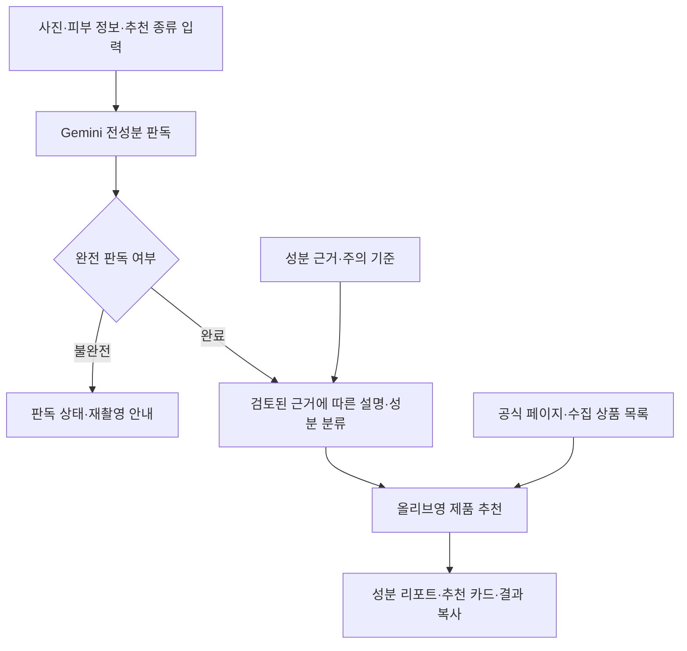

# ✦ GlowPick

**화장품 전성분을 읽고, 피부 고민에 맞는 성분 정보와 스킨케어 제품 후보를 확인하는 서비스**

전성분 라벨 사진과 피부 정보를 입력하면 Gemini가 사진을 판독합니다. 앱은 판독한 성분을 검토된 자료와 대조해 도움과 관련된 기능, 주의해서 볼 성분, 추가 확인이 필요한 성분을 구분합니다. 분석을 완료하면 **GlowPick 추천!**에서 올리브영 스킨케어 제품도 확인할 수 있습니다.

[웹에서 사용하기](https://yumin0601-glowpick.static.hf.space/index.html) · [Hugging Face Space](https://huggingface.co/spaces/yumin0601/GlowPick) · [Android 빌드 결과](https://github.com/yumin0117/GlowPick/actions/runs/43780310567)

> 최종 통합 소스는 **main**을 기준으로 관리합니다. 추가 기능을 담당 브랜치별로 분리하지 않고, 한국 브랜드 100개 검증과 Android 앱을 포함한 통합 작업을 main에서 유지합니다. 개인 브랜치는 기존 작업 이력으로 보존합니다.

## 주요 기능

### 화장품 성분 분석

- 한 제품의 전성분 라벨 사진을 판독하고 성분 목록과 원문을 표시합니다.
- 피부 타입과 여러 피부 고민을 함께 선택할 수 있습니다.
- 글리세린 외에도 검토된 근거가 있는 보습·피부 컨디셔닝 성분을 연결합니다.
- 판독된 성분과 사용자 조건에 해당하는 경우 향료 등 주의해서 확인할 일반 안내를 표시합니다.
- 근거가 부족한 성분은 추가 확인 항목으로 구분합니다.
- 일부 판독·판독 불가·여러 제품 감지 등의 상태를 완료 결과와 구분합니다.
- 결과 복사로 성분 목록과 안내를 저장할 수 있습니다.

### 모델링팩 컨설팅

모델링팩 전성분과 피부 고민을 확인하고 에센스·세럼·앰플 후보를 추천합니다. 제품 추천은 특정 모델링팩에 섞어도 된다는 허용 판정이 아닙니다. 정확한 제품·버전·사용 조건의 근거가 없으면 **혼합 가능 여부 미확인**으로 안내하며 제조사의 사용법을 우선합니다.

### GlowPick 추천!

| 분석 서비스 | 추천받을 수 있는 종류 | 선택 제한 | 선택했을 때 | 선택하지 않았을 때 |
| --- | --- | --- | --- | --- |
| 화장품 성분 분석 | 스킨·토너·에센스·세럼·앰플·크림·로션 | 선택 사항, 최대 3종 | 선택한 종류마다 서로 다른 제품 1개 | 허용 종류 중 최대 3개 |
| 모델링팩 컨설팅 | 에센스·세럼·앰플 | 선택 사항, 최대 1종 | 선택한 종류의 제품 1개 | 허용 종류 중 최대 3개 |

여러 고민을 선택하면 함께 고려해 후보를 비교합니다. 스킨과 토너는 구분하며, 선택한 종류를 다른 종류로 임의 대체하지 않습니다.

추천은 다음 순서로 처리합니다.

1. Gemini가 올리브영 공식 카테고리 페이지를 읽고 조건에 맞는 제품 후보를 찾습니다.
2. 부족한 종류가 있으면 수집된 공식 목록을 제공해 실제 상품 ID를 선택하게 합니다. 제품명·브랜드·사진·상품 주소는 해당 ID의 자료에서 연결합니다.
3. 추천 API가 지연되거나 완료되지 않으면 같은 수집 목록의 상품명에 표시된 관리 특징과 고민·종류를 비교합니다. 이 경우 화면에 목록 비교 추천임을 안내하며 AI 실호출 성공으로 기록하지 않습니다.

추천용 수집 목록은 **122개 상품**이며, 한국 브랜드 100개 판독 테스트 자료와 별개입니다. 몇 개의 추천 상품을 직접 고정한 목록은 아니지만 올리브영 전체 재고도 아닙니다. 요청마다 자동 재수집되지 않으므로 새 상품·단종·리뉴얼과 현재 판매 여부를 모두 즉시 반영하지는 못합니다.

링크나 사진이 없어도 확인된 제품명과 추천 이유를 표시합니다. 확인한 공식 상품 주소가 있으면 바로가기를 제공하고, 제품 사진은 확인된 공식 CDN 주소가 있을 때 표시합니다. 사진 로딩이 실패해도 제품 카드는 유지합니다.

현재 화면과 결과 복사에는 수집·조회 시간을 표시하지 않습니다. **‘다시 추천 받기’ 버튼은 제거했으며**, 최초 성분 분석 완료 후의 제품 추천을 제공합니다.

## 사용 방법

1. 웹 또는 설치한 Android 앱을 엽니다.
2. 본인의 Gemini API 키를 입력합니다. 수업 시연에서는 결제가 연결되지 않은 무료 프로젝트 키를 사용합니다.
3. 화장품 성분 분석 또는 모델링팩 컨설팅을 선택합니다.
4. 한 제품의 전성분 전체가 보이는 사진을 올리거나 촬영합니다.
5. 피부 타입과 고민을 선택합니다. 피부 타입을 모르면 ‘잘 모르겠음’을 선택할 수 있습니다.
6. 원하는 추천 종류를 선택하거나 비워 둔 뒤 분석합니다.
7. 성분 리포트와 제품 추천을 확인하고, 필요하면 결과를 복사합니다.

지원 파일은 **JPG/JPEG·PNG·WEBP 정지 이미지**, 최대 **10MiB·2,400만 픽셀**입니다.

API 키는 현재 탭에서 반복 분석할 때 재사용합니다. 새로고침·페이지 이동·탭 닫기 또는 앱 화면 재생성 시 초기화합니다. 브라우저 저장소에 저장하지 않으며 앱에 공용 키를 포함하지 않습니다. 키와 사진·피부 입력은 분석을 위해 브라우저에서 Google로 직접 전송됩니다. API 이용 요금과 한도는 입력한 키의 프로젝트 설정을 따릅니다.

## 동작 구조



Hugging Face에서는 **Static Space**로 실행합니다. 화면과 API 클라이언트가 브라우저에 있고 Google Gemini API에 직접 요청하므로 별도 운영 서버나 HF Secrets가 필요하지 않습니다. 코드에 설정된 모델은 `gemini-3.5-flash-lite`, 판독·설명 프롬프트 버전은 `v2-2026-11-04`입니다.

기존 Python·Gradio 구현은 비교와 회귀 검사 용도로 보관합니다. 현재 웹과 Android 앱의 운영 경로는 `BeautyAI/`의 JavaScript 모듈입니다.

## 프로젝트 구성

| 경로 | 역할 |
| --- | --- |
| `BeautyAI/index.html`, `style.css`, `script.js` | 화면, 입력·사진 관리, 탭 내 키 재사용, 결과 표시 |
| `BeautyAI/api-client.js` | 성분 분석·제품 추천 클라이언트 연결 |
| `BeautyAI/gemini-client.js` | 사진 판독·설명 API 요청, 이미지 검사, 실패 단계·오류 진단 |
| `BeautyAI/recommendation-client.js` | 올리브영 조회, 추천 지시, 종류·주소 검사, 목록 기반 추천 처리 |
| `BeautyAI/report-model.js` | 근거 대조, 도움·주의·추가 확인 분류, 추천 상태와 복사 결과 구성 |
| `BeautyAI/ai-core.js` | 응답 스키마·판독 상태 검사 |
| `BeautyAI/ai-assets.js` | 스키마·프롬프트·성분 근거·상품 목록의 자동 생성 묶음 |
| `prompts/` | 판독·설명 프롬프트 원본 |
| `data/` | 성분 기능·주의 기준·출처·추천 상품 목록 |
| `reference/` | 기존 성분 비교용 자료와 검증 도구 |
| `tests/` | 웹 기능·API 계약·오류 처리 자동검사 |
| `scripts/` | 로컬 실행, 자료 정리, 자산 생성, 배포 파일 구성 |
| `mobile/` | Capacitor 기반 Android 시연 앱과 설치·빌드 안내 |
| `.github/workflows/android-demo.yml` | APK 빌드·lint·에뮬레이터 검사 |
| `glowpick/`, `app.py` | 이전 Python 구현과 비교·회귀 검사 |
| `docs/` | 기능 변경·통합·검증·배포 기록 |

팀의 기존 담당은 **mj: API·서버 연동 / kyoungmin_oh: 프롬프트 / ysw: 성분표 수집·검증 / ym: 화면**입니다. 최종 기능은 main에 통합해 관리합니다.

## 파트별 구현 내용 — 발표 자료용

아래는 기존 담당 결과물과 현재 main에서 이어지는 역할을 기준으로 정리했습니다. 최초 개인 작업 이후 추가된 올리브영 추천·성분 안내 확대·100개 제품 검사·Android 앱은 뒤의 **main 공통 통합·확장 작업**에서 별도로 설명합니다. 현재 파일을 담당 브랜치로 다시 나누거나, 기존 작업 이력을 변경한 것은 아닙니다.

### 1. mj — API·서버 연동과 응답 처리

**담당 목표:** 화면에서 받은 사진과 피부 정보를 AI에 전달하고, 앱에서 사용할 수 있는 일정한 형식의 결과로 돌려주는 처리 흐름을 구현했습니다.

**기존 담당 결과물과 main의 연결**

- 초기에는 Python·Gradio 기반의 Gemini 연동과 화면 연결을 구성했습니다. `app.py`와 `glowpick/`에 해당 구현을 보관합니다.
- 이후 운영 경로를 Hugging Face Static에 맞춰 브라우저 직접 호출 방식으로 구성했습니다. 현재 앱은 별도 Python 서버를 실행하지 않고 JavaScript 클라이언트가 Google에 요청합니다.
- 사진 판독과 성분 설명을 두 단계로 구분했습니다. 판독이 완료된 경우에만 검토된 근거가 있는 성분을 골라 설명 단계로 전달합니다.
- 요청·응답의 공통 구조를 정리해 화면·프롬프트·데이터 파트가 같은 필드와 상태를 사용하도록 연결했습니다.

**현재 main에서 이 파트가 담당하는 처리**

| 처리 | 구현 내용 | 사용자가 확인하는 결과 |
| --- | --- | --- |
| 이미지 입력 검사 | 확장자·MIME·실제 파일 내용·용량·해상도·정지 이미지 여부 확인 | 지원하지 않는 파일을 분석 전에 안내 |
| AI 요청 | 키를 요청 헤더로 전달하고 판독·설명 API 호출 | 사진에서 읽은 성분과 근거에 따른 설명 |
| 응답 검사 | JSON 형식·필수 필드·판독 상태·성분명·근거 ID 연결 확인 | 잘못된 응답을 완료된 분석처럼 표시하지 않음 |
| 설명 범위 제어 | 판독된 성분과 검토 자료에 함께 존재하는 근거만 사용 | 자료에 없는 성분은 추가 확인 항목으로 구분 |
| 요청 상태 관리 | 동시 요청·분당 횟수·시간 제한 적용 | 처리 중 중복 실행과 무제한 요청 방지 |
| 오류 처리 | 인증·한도·과부하·콘텐츠 차단·응답 검증 오류와 실패 단계 구분 | 문제가 발생한 단계와 확인할 내용을 안내 |

**주요 파일**

- `BeautyAI/api-client.js`: 화면이 사용하는 분석·추천 함수의 연결 지점
- `BeautyAI/gemini-client.js`: Gemini 호출, 판독·설명 단계 진행, 이미지 검사와 오류 처리
- `BeautyAI/ai-core.js`: 출력 스키마와 판독 결과 검사
- `glowpick/models.py`: 공통 데이터 구조의 원본
- `glowpick/service.py`, `glowpick/gemini.py`, `app.py`: 기존 Python 구현
- `scripts/package_static.py`, `scripts/deploy_existing_space.py`: 배포 파일 구성과 기존 Space 업데이트 도구

**협업 관계:** ym이 전달한 입력을 받아 kyoungmin_oh의 지시문으로 AI를 호출하고, ysw의 근거 자료와 결과를 대조한 뒤 화면에 전달합니다.

**발표 설명 예시**

> API·서버 파트는 사진 입력부터 AI 응답까지의 처리 흐름을 연결했습니다. 판독과 설명을 분리하고, 응답 형식과 성분·근거 연결을 코드로 확인했습니다. 현재 서비스는 브라우저가 Gemini를 직접 호출하는 구조이며, API 오류도 종류와 단계에 따라 구분해서 보여줍니다.

### 2. kyoungmin_oh — 판독·설명 프롬프트 설계

**담당 목표:** AI가 사진에서 무엇을 읽어야 하고, 어떤 자료로 어디까지 설명해야 하는지를 명확한 지시문으로 설계했습니다.

**기존 담당 결과물과 main의 연결**

- 사진 판독용 `extract.txt`와 성분 설명용 `explain.txt`를 분리해 작성했습니다.
- 판독·설명 사례를 나누어 실행하고, 상태 판정과 전성분 일치·설명 규칙 준수 여부를 확인하는 평가 자료를 구성했습니다.
- 최종 판독·설명 프롬프트 `v2-2026-11-04`를 main에 적용했습니다. 두 원본 파일은 해당 담당 브랜치의 최종본과 같습니다.

**사진 판독 프롬프트에서 정한 내용**

1. 제품명이나 브랜드를 알아도 기억으로 성분을 채우지 않고 사진에 보이는 글자만 읽습니다.
2. 한 제품의 전성분이 처음부터 끝까지 보이는지에 따라 완료·부분 판독·판독 불가·전성분 없음·여러 제품 상태를 구분합니다.
3. ‘주요 성분’이나 효능별 소개표를 전체 전성분으로 판단하지 않도록 기준을 명시합니다.
4. 성분 순서와 국문·영문 표기를 유지하고 괄호·슬래시·숫자 쉼표를 성분의 일부로 처리합니다.
5. 불확실한 글자를 추측해 완성하지 않고 별도 불확실 구간과 다음 촬영 안내로 남깁니다.
6. 사진 속 명령문과 개인정보를 분석 지시나 결과 내용으로 사용하지 않도록 제한합니다.

**성분 설명 프롬프트에서 정한 내용**

- 서버·클라이언트가 전달한 검토 근거 안에서만 성분의 일반 기능을 설명합니다.
- 판독 목록에 없는 성분이나 다른 성분의 근거 ID를 새로 붙이지 않도록 합니다.
- 사용자 고민과 연결하더라도 완제품 효과·개인 적합성·모델링팩 혼합 가능 여부를 확정하지 않습니다.
- 쉬운 해요체로 요약하고, 피부 타입을 모르는 사용자에게 특정 타입을 추측하지 않도록 합니다.
- 지정된 JSON 구조로 응답해 실행 코드가 결과를 검사할 수 있도록 합니다.

**주요 파일과 연결 위치**

- `prompts/extract.txt`: 사진에서 전성분을 읽는 규칙과 판독 상태 기준
- `prompts/explain.txt`: 근거 기반 설명·요약·안내 작성 규칙
- `BeautyAI/ai-assets.js`: 두 원본 지시문을 포함한 자동 생성 묶음
- `BeautyAI/gemini-client.js`: 지시문과 입력·출력 스키마를 실제 요청으로 연결하는 실행 코드

후속으로 추가한 **올리브영 추천 지시문은 현재 `BeautyAI/recommendation-client.js` 안에 있으며 main 공통 확장 기능**입니다. 개인 브랜치의 기존 판독·설명 프롬프트에 새 추천 기능이 처음부터 포함되어 있었던 것으로 설명하지 않습니다.

**협업 관계:** mj의 입력·출력 규격과 ysw의 근거 범위에 맞춰 지시문을 작성하고, 그 결과를 ym의 화면에서 이해하기 쉽게 보여줄 수 있도록 구조화합니다.

**발표 설명 예시**

> 프롬프트 파트는 전성분을 읽는 단계와 기능을 설명하는 단계를 따로 설계했습니다. 광고 문구와 전체 전성분을 구분하고, 잘린 사진이나 읽기 어려운 사진을 완료 상태로 처리하지 않도록 기준을 만들었습니다. 설명 단계에서는 검토된 근거만 사용하도록 제한해 AI가 임의로 성분이나 효능을 덧붙이는 문제를 줄이고자 했습니다.

### 3. ysw — 전성분 자료 수집·정답 비교·근거 관리

**담당 목표:** 분석에 사용할 자료의 출처를 정리하고, AI가 읽은 성분을 비교할 기준과 설명에 사용할 근거를 준비했습니다.

**기존 담당 결과물과 main의 연결**

- 제품·이미지·성분·출처·이미지와 임시 정답의 대응 관계를 정리했습니다.
- 기존 인계 패키지는 제품 6개, 제조사 웹 이미지 12개, 제품별 크롭을 포함한 이미지–임시 정답 5쌍을 기준으로 구성했습니다. 같은 제품의 여러 이미지가 포함되므로 독립 제품 수와 이미지 수를 구분했습니다.
- 성분 목록의 누락·추가·중복·순서 차이를 계산하는 비교 도구를 만들었습니다.
- 글리세린·판테놀·알란토인의 일반 기능에 관한 한영 근거 6행을 팀 규격에 맞춰 인계했습니다. 이후 main에서 근거와 조건부 주의 자료를 확장했습니다.
- 별도 OCR 후보 실험 결과는 비교 자료로 관리하며, 그 수치를 현재 서비스의 Gemini 정확도로 합산하지 않습니다.

**현재 main에서 이 파트와 연결되는 자료·검사**

| 자료·도구 | 정리한 내용 | 앱과 검증에서의 쓰임 |
| --- | --- | --- |
| 제품·이미지 기준 자료 | 제품 식별 정보, 성분 원문, 이미지 사례, 출처 | 어떤 이미지와 제품을 비교했는지 추적 |
| 성분 비교 도구 | 표기 정규화, 누락·추가·중복·순서 차이 계산 | API 완료 상태와 실제 전사 일치를 구분 |
| 일반 기능 근거 | 성분명, 근거 ID, 기능 설명, 출처 | 설명 단계에 전달할 근거 선택 |
| 조건부 안내 자료 | 고민과 연결할 기능 기준, 성분명 별칭, 조건부 주의 문구 | 도움·주의·추가 확인 항목 구성 |
| 추천 상품 자료 | 공식 목록에서 확인한 상품 ID·제품명·종류·주소·사진·출처 | 존재하지 않는 제품명을 생성하지 않고 원본과 연결 |

현재 main에는 **기능 근거 36행, 도움 연결 규칙 13개, 조건부 주의 규칙 13개, 추천 상품 122개**가 있습니다. 한영 표기 등 별도 행이 포함되므로 근거 36행을 서로 다른 성분 36종으로 발표하지 않습니다. 이 수치는 초기 개인 인계 자료 이후의 main 확장을 포함합니다.

**주요 파일**

- `reference/data/`: 제품·성분·근거·이미지 사례와 비교용 자료
- `reference/src/compare.mjs`, `ingredient-validation.mjs`: 성분 비교와 검증 규칙
- `glowpick/validation.py`: 기존 Python 경로에서 사용하는 대응 검증 코드
- `data/reviewed_claims.json`, `reviewed_claims.provenance.json`: 기능 근거와 출처·검토 범위
- `data/reviewed_guidance.json`: 도움 연결 기준과 조건부 주의 안내
- `data/retail_listings.json`, `scripts/import_retail_listings.mjs`: main에서 추가한 추천 상품 자료와 목록 정리 코드

**협업 관계:** mj에는 근거와 비교 기준을 전달하고, kyoungmin_oh에는 설명 가능한 범위와 판독 사례를 제공합니다. ym의 결과 화면에는 근거가 확인된 항목과 추가 검토 항목을 구분할 기준을 제공합니다.

**발표 설명 예시**

> 데이터 파트는 전성분 이미지와 제품·출처 정보를 정리하고, AI 출력에서 어떤 성분이 빠지거나 추가됐는지 비교할 수 있는 도구를 만들었습니다. 일반 성분 기능의 근거도 별도로 관리해 설명 단계에 연결했습니다. 정답의 사람 교차검토 여부와 모델별 시험 결과를 구분하여, 완료 응답을 곧바로 정확도나 안전성으로 해석하지 않도록 했습니다.

### 4. ym — 사용자 화면과 입력·결과 표시

**담당 목표:** 사용자가 사진과 피부 정보를 쉽게 입력하고, 분석 상태와 결과를 구분해 확인할 수 있는 웹 화면을 구현했습니다.

**기존 담당 결과물과 main의 연결**

- HTML·CSS·JavaScript로 GlowPick의 랜딩 화면과 탭형 서비스 화면을 구성했습니다.
- ‘화장품 성분 분석’과 ‘모델링팩 컨설팅’을 같은 페이지에서 전환하도록 만들었습니다.
- 사진 선택·촬영·미리보기·삭제, 피부 타입·복수 고민 선택, 추가 입력 폼을 구현했습니다.
- 모델링팩 탭에서 화장품 분석의 고민을 가져오는 기능과 결과 복사 기능을 구성했습니다.
- 도움 성분·주의 성분·추가 확인 항목·일반 기능을 나눠 보여주는 결과 화면을 만들었고, main에서 실제 API 응답과 연결했습니다.

**현재 main에서 화면이 담당하는 흐름**

1. 사용자가 키·사진·피부 정보·원하는 추천 종류를 입력합니다.
2. 파일 조건과 필수 입력을 안내하고 분석 중에는 중복 실행을 막습니다.
3. 응답을 받은 뒤 판독 상태와 성분 리포트를 표시합니다.
4. 추천이 진행되는 동안 성분 결과를 유지하고, 완료된 제품명을 카드로 표시합니다.
5. 확인된 사진과 상품 링크를 표시하고, 사진 로딩 실패 시에도 제품명과 설명을 유지합니다.
6. 화면의 결과를 복사할 수 있도록 텍스트를 구성해 전달합니다.

피부 고민별 추천 종류 선택, 같은 탭에서의 키 재사용, 새 추천 카드, 수집 시간 표시 제거와 재추천 버튼 제거는 **기존 화면을 기반으로 main에서 추가·수정한 내용**입니다.

**주요 파일**

- `BeautyAI/index.html`: 입력 폼·탭·결과 영역의 구조
- `BeautyAI/style.css`: 색상·배치·카드·상태 표현·반응형 화면
- `BeautyAI/script.js`: 입력 이벤트·사진 미리보기·탭 전환·API 호출 연결·결과 출력
- `BeautyAI/report-model.js`: 실행 처리와 화면 사이에서 리포트·추천·복사 내용을 구성하는 공통 연결 파일

main은 모듈로 분리된 소스를 사용합니다. 기존 ym 전달본은 같은 기능을 HTML·CSS·JS 세 파일로 묶은 형태입니다. 세 파일 안에 실행 코드가 포함되어 있다고 해당 실행 기능 전체를 화면 파트의 단독 구현으로 설명하지 않습니다.

**협업 관계:** 입력을 mj의 API 규격에 맞춰 전달하고, 프롬프트 결과와 ysw의 근거 분류가 사용자에게 이해되도록 표시합니다.

**발표 설명 예시**

> 화면 파트는 사진 업로드부터 결과 확인까지의 사용 흐름을 구현했습니다. 두 서비스를 탭으로 나누고 사진 미리보기, 피부 고민 복수 선택, 결과 카드와 복사 기능을 구성했습니다. 통합 과정에서는 실제 API 상태와 제품 추천을 연결하고 모바일에서도 읽기 쉽도록 화면을 정리했습니다.

### 5. main 공통 통합·확장 작업

다음은 위의 담당 결과물을 연결한 뒤 추가한 프로젝트 수준의 작업입니다. 개인 브랜치로 재분배하지 않고 main에 유지합니다.

| 작업 | 구현·수정한 내용 | 관련 파트와 파일 |
| --- | --- | --- |
| 올리브영 제품 추천 | 복수 고민 반영, 종류별 추천, 공식 목록 조회와 상품 ID 선택, API 지연 시 목록 비교 추천 | 실행·지시문·자료·화면이 결합된 `recommendation-client.js`, `api-client.js`, `report-model.js`, `retail_listings.json`, 화면 세 파일 |
| 성분 분석 결과 개선 | 글리세린 외 일반 기능 확대, 조건부 주의 안내 연결, 반복 문장 정리 | 근거·안내 JSON, `report-model.js`, `ai-assets.js`, 화면 |
| 사용 편의 개선 | 탭 내 키 재사용, 추천 사진·링크 표시, 수집 시간과 재추천 버튼 제거 | `script.js`, `index.html`, `style.css`, `report-model.js` |
| 오류 진단 개선 | HTTP 상태·실패 단계·허용된 오류 코드 보존, 콘텐츠 차단과 형식 오류 구분 | `gemini-client.js`, `script.js`, API 관련 검사 |
| 한국 브랜드 100개 검사 | 공식 전성분표 수집, 100개 업로드·실호출 시도, 원문 대조와 오류 재검사 | main 통합 검증 기록과 로컬 검증 패키지; 아래 검증 기록 참고 |
| 웹 배포 | 기존 HF Static Space 업데이트, 배포 묶음과 공개 파일 일치 확인 | `scripts/package_static.py`, `deploy_existing_space.py` |
| Android 앱 | 웹 파일 9개를 APK로 구성, 빌드·lint·에뮬레이터 검사와 설치 파일 준비 | `mobile/`, Android 워크플로 |

공통 생성 파일 `BeautyAI/ai-assets.js`는 프롬프트·성분 자료·스키마·상품 목록을 합칩니다. 원본 담당의 자료를 바꾼 뒤 생성 도구를 실행해 연결하며, 생성 결과를 각자의 독립 원본처럼 따로 수정하지 않습니다.

### 6. PPT 구성 예시

| 슬라이드 | 핵심 내용 | 보여줄 자료 |
| --- | --- | --- |
| 1. 프로젝트 소개 | 전성분 이해의 어려움, 대상 사용자, 두 가지 서비스 | 첫 화면과 서비스 목표 |
| 2. 역할 분담·전체 구조 | 네 파트의 입력·처리·출력 관계, main 통합 방식 | 역할 표와 동작 구조도 |
| 3. API·서버 파트 | 판독·설명 단계 분리, 응답 검사, 오류 처리 | 요청 흐름과 상태 구분 |
| 4. 프롬프트 파트 | 전체 전성분과 광고 구분, 불확실성 처리, 근거 기반 설명 | 판독·설명 규칙의 핵심 예시 |
| 5. 데이터 파트 | 제품·이미지·출처 관리, 누락·중복·순서 비교, 일반 기능 근거 | 자료 구조와 비교 결과 예시 |
| 6. 화면 파트 | 업로드·고민 선택·탭 전환·결과 카드 | 실제 화면 캡처와 사용 순서 |
| 7. 통합 후 추가 기능 | 올리브영 추천, 성분 안내 확대, 편의 기능 | 여러 고민·제품 종류 선택 예시 |
| 8. 검증·배포 | 한국 제품 100개 결과, 자동검사, HF·APK | 성공·오류를 구분한 표와 실행 화면 |
| 9. 한계·개선 방향 | 오독·API 가용성, 사람 교차검토, 상품 목록 갱신, 휴대폰 실호출 | 확인된 한계와 다음 작업 |

발표에서는 **담당 결과물**, **main 통합 후 추가 기능**, **실제로 검증한 범위**를 나눠 설명합니다. 특히 프롬프트 사례 평가, 한국 제품 100개 검사, 추천 모듈 실호출, Android 에뮬레이터 검사를 하나의 정확도 수치로 합치지 않습니다.

## 로컬 실행

Node.js 22 이상에서 저장소 루트를 기준으로 실행합니다. 화면 미리보기에는 npm 패키지 설치가 필요하지 않습니다.

```powershell
node scripts/dev-static.mjs
```

브라우저에서 [http://127.0.0.1:8080/](http://127.0.0.1:8080/)을 엽니다. API 키는 실행 화면에 직접 입력합니다. `file://`로 HTML을 열면 모듈이 제한되므로 로컬 HTTP 서버를 사용합니다.

프롬프트·성분 자료·상품 목록·모델 스키마를 수정한 경우, 프로젝트 Python 의존성을 설치한 환경에서 공개 자산을 다시 생성합니다.

```powershell
python scripts/build_static_assets.py
```

`ai-assets.js`는 생성 결과이므로 해당 원본을 먼저 수정합니다.

## Hugging Face 배포

대상은 기존 [yumin0601/GlowPick](https://huggingface.co/spaces/yumin0601/GlowPick) Space입니다.

```powershell
python scripts/package_static.py GlowPick_HF_Final.zip
```

프로젝트 Python 의존성이 설치된 환경에서 실행합니다. ZIP에는 README와 공개 웹 파일 9개, 총 10개 파일이 들어갑니다. 압축을 풀어 Space 루트에 업로드합니다. 배포용 README는 `sdk: static`, `app_file: index.html`로 생성됩니다. Python 코드·가상환경·사진 시험 자료·API 키는 배포 묶음에 포함하지 않습니다.

2026-11-16 확인 기준, 웹 배포 커밋은 [`447aeac`](https://huggingface.co/spaces/yumin0601/GlowPick/commit/447aeacaa7ecdb483188635e7fc81c381ad091ea)입니다. 당시 RUNNING 상태와 공개 웹 파일 9개의 배포본 일치를 확인했습니다. GitHub 소스 수정은 기존 HF Space에 자동 반영되지 않으므로 웹 코드가 바뀌면 다시 배포합니다.

## Android APK

Google Play 등록 없이 휴대폰에 직접 설치하는 수업 시연용 앱입니다. `BeautyAI/`의 공개 웹 파일 9개를 Capacitor 8.6.0으로 묶습니다.

- 앱 이름: **GlowPick**
- 패키지: `io.github.yumin0117.glowpick`
- 버전: `0.1.0-demo`
- 최소 Android API: 24
- 배포 형식: 디버그 서명 APK

[검증 완료 빌드의 아티팩트](https://github.com/yumin0117/GlowPick/actions/runs/43780310567/artifacts/14188146366)에서 GitHub 로그인 후 ZIP을 내려받고 `GlowPick-Android-demo.apk`를 휴대폰으로 옮겨 설치합니다. 기존 데모와 서명이 달라 업데이트 설치가 거절되면 기존 데모를 삭제한 뒤 설치합니다. 아티팩트는 30일 보관되므로 수업용 파일은 별도로 보관합니다.

main의 웹·모바일 코드가 바뀌면 기존 APK 빌드 워크플로가 실행됩니다. 앱에 화면 파일이 포함되므로 웹 코드 수정 후 Android에서도 사용하려면 새 APK를 빌드하고 설치해야 합니다.

로컬 빌드에는 Node.js 22 이상, Java 21, Android SDK 36이 필요합니다.

```powershell
cd mobile
npm ci --ignore-scripts
npm run sync
cd android
.\gradlew.bat assembleDebug
```

출력은 `mobile/android/app/build/outputs/apk/debug/app-debug.apk`입니다. 상세 안내는 [mobile/README.md](mobile/README.md)를 참고하세요.

## 검증 기록

### 기능 자동검사

```powershell
npm test
python -m unittest discover -s tests -v
node --test reference/tests/validation.test.mjs
```

2026-11-16 Android 빌드에서 웹 자동검사 **67건**, Android lint와 API 35 에뮬레이터 계측 검사 **1건**이 통과했습니다. 해당 계측 검사는 앱 실행·가로 넘침·빈 키 초기 상태·사진 선택 및 미리보기·탭 전환·키 입력 안내를 함께 확인합니다.

최종 APK의 공개 웹 파일 9개가 빌드 소스와 일치함을 확인했습니다. Android의 화면 안전 영역을 위한 HTML·CSS 보정은 포함됩니다. 실제 휴대폰 카메라와 Android 안의 Gemini 실호출은 에뮬레이터 검사 범위에 포함되지 않습니다.

### 한국 브랜드 100개 실제 앱 검사

추천 기능 추가 전 성분 분석 수정본의 검사 기록이며, 현재 모든 추천 종류를 100개 제품으로 검증했다는 의미는 아닙니다.

| 항목 | 당시 기록 |
| --- | --- |
| 자료 | 한국 브랜드 100개 제품의 공식 전성분표 화면 캡처 |
| 파일·브라우저 업로드 검사 | 100개 통과 |
| 실제 Gemini 분석 시도 | 100개 |
| 판독 완료 상태 | 58개 |
| 여러 제품 감지 상태 | 3개 |
| API 오류 | 39개: `GEMINI_UNAVAILABLE` 35개, 당시 `GEMINI_REQUEST_REJECTED` 4개 |
| 공식 페이지 텍스트와 자동 순서 대조 | 완료 58개 중 18개 일치, 40개 추가 검토 대상 |

`complete`는 모델의 완료 상태이며 정확한 전사를 보증하는 점수가 아닙니다. 자동 대조 기준도 공식 페이지의 표시 텍스트로, 독립된 사람의 정답 교차검토를 완료한 자료는 아닙니다. 이후 오류 재검사는 최초 100개 결과와 별도로 기록했으며, 재검사 성공으로 최초 오류를 덮어쓰지 않았습니다.

원본 이미지·파일별 응답·출처·대조 결과는 로컬 검증 패키지에 보관합니다. 공개 코드와 실제 대용량 시험 파일의 보관 위치를 구분하며, 이 자료를 담당 브랜치로 분리하지 않습니다.

### 추천 기능 확인

별도 추천 모듈 실호출에서 스킨·토너·앰플 세 종류의 실제 제품명을 확인했고, 운영 추천 렌더러에서 카드와 공식 제품 사진 로딩을 확인했습니다. 이는 사진 판독부터의 전체 흐름을 모든 제품·종류에서 실호출 검증한 결과는 아닙니다.

## 결과를 읽을 때

- 성분 기능은 검토된 일반 기능 자료에 한정합니다. 완제품 효능이나 개인별 적합성·치료 효과를 판정하지 않습니다.
- 근거가 없는 성분은 `needs_evidence`, 일반 기능 설명은 `reference_only`, 확인하지 못한 혼합은 `unknown`으로 구분합니다. 주의 안내가 없다고 모든 성분이 안전하다는 의미는 아닙니다.
- 추천 상품의 현재 성분·가격·재고·사용법은 구매 전 상품 페이지와 제조사 안내에서 확인해야 합니다.
- 분석은 탭 내 동시 요청과 분당 횟수를 제한합니다. 성분 분석의 각 API 요청 제한은 기본 45초, 추천의 각 요청은 60초입니다. 무료 API 한도·서비스 과부하·콘텐츠 제한으로 실패할 수 있으며 유료 모델로 자동 전환하지 않습니다.

## 상세 문서

- [추천 기능의 현재 경로와 변경 기록](docs/FINAL_PRODUCT_NAMES_20261112.md)
- [성분 기능·조건부 주의 안내](docs/INGREDIENT_GUIDANCE_20261110.md)
- [API 규격](docs/API.md)
- [Gemini 오류 원인과 진단 수정](docs/API_ERROR_REVIEW_20261111.md)
- [현재 탭에서 API 키 재사용](docs/TAB_KEY_REUSE.md)
- [Static 전환 기록](docs/STATIC_MIGRATION_20261102.md)
- [Android 앱 빌드·설치](mobile/README.md)

이전 문서는 작성 당시의 구현과 결과를 기록합니다. 현재 사용법과 동작은 이 README 및 최신 코드, 기능별 후속 변경 기록을 함께 기준으로 확인합니다.
